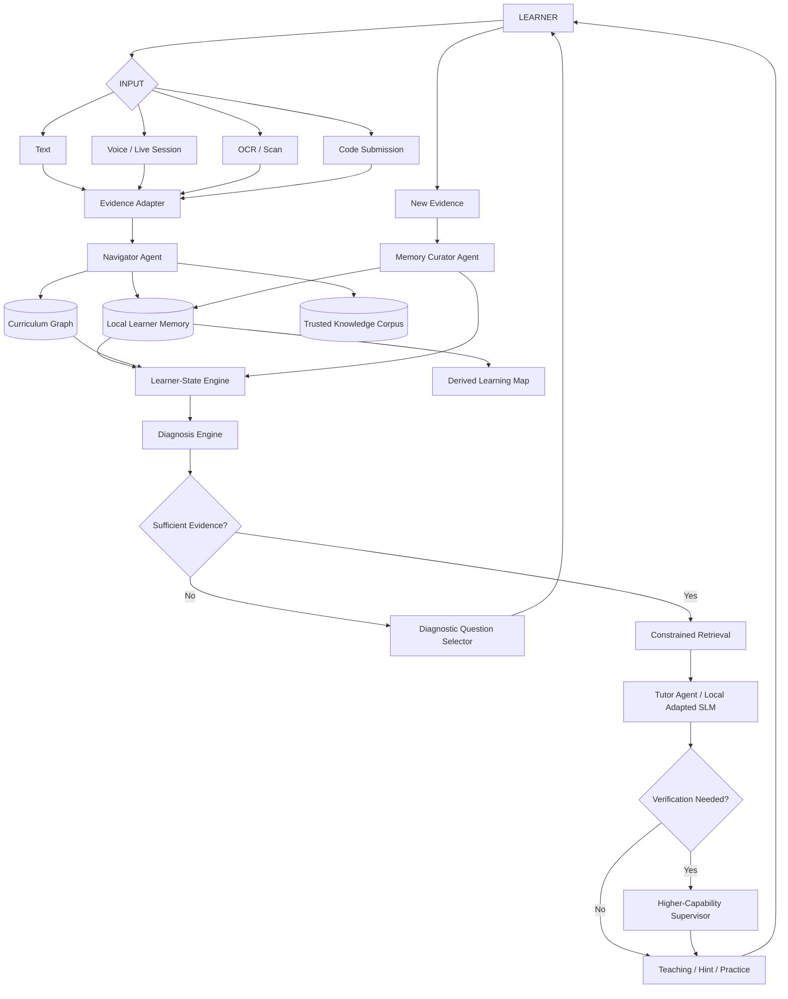

# FINAL — Adaptive Learning Diagnosis + Personalized Companion
## Unified Architecture, Mathematics, Product Design, Memory, Model Plan, and Hackathon Execution

**Status:** Final architecture candidate after re-auditing the previous plan against current 2026 adaptive-tutoring systems, local-AI constraints, long-term learner-memory requirements, and the official internal hackathon statements.

**Official problem alignment**
- **PS17 — Learning Gap Detection System**
- **PS10 — AI-Based Personalized Learning Companion**

If the hackathon requires a single Problem Statement ID, submit under **PS17** and present PS10 as the remediation/companion layer that closes the loop. If dual-ID submission is explicitly allowed, declare both.

---

# 0. Executive Decision

We are **not** building:

- a generic chatbot;
- a generic RAG tutor;
- a huge multi-agent swarm;
- an education super-app;
- a GraphRAG demo;
- a dashboard that only shows marks;
- a system that permanently labels the learner;
- a cloud database containing the user's long-term learner memory.

We are building one closed-loop adaptive system:

> **Observe how a learner thinks, maintain an evolving local learner model, form and test learning-gap hypotheses, teach only after sufficient evidence exists, verify whether the intervention worked, and use the result to decide the next action.**

The whole system reduces to:

```text
OBSERVATION
    ↓
LEARNER-STATE UPDATE
    ↓
DIAGNOSIS / UNCERTAINTY
    ↓
NEXT ACTION
    ├── ask diagnostic
    ├── teach
    ├── hint
    ├── practice
    └── reassess
    ↓
NEW OBSERVATION
    ↓
LOOP
```

Mathematically:

\[
B_t = P(Z_t \mid H_t, G_K)
\]

\[
a_t = \pi(B_t, G_K, K, x_t)
\]

\[
o_{t+1} = \operatorname{Evaluate}(u, a_t)
\]

\[
B_{t+1} = \operatorname{Update}(B_t,o_{t+1})
\]

where:

- \(Z_t\) = latent learner knowledge state;
- \(B_t\) = current belief about that state;
- \(H_t\) = observed learner history;
- \(G_K\) = curriculum/knowledge graph;
- \(K\) = trusted learning corpus;
- \(x_t\) = current context;
- \(a_t\) = selected learning action;
- \(o_{t+1}\) = new learner evidence.

Everything else—voice, OCR, code review, RAG, agents, QLoRA, visual graphs—is an interface or subsystem supporting this loop.

---

# 1. Why the Previous Design Needed to Change

The earlier plan contained many individually reasonable pieces, but it was becoming architecturally fragmented:

- four agents;
- multiple independent engines;
- a separate gap score;
- daily → weekly → monthly → yearly memory objects;
- hot/warm/cold memory as a physical architecture;
- a large weighted GraphRAG equation;
- domain-specific LoRA adapters;
- too many frontend screens;
- too many partially overlapping scores.

That creates four problems:

1. **Implementation cost grows faster than value.**
2. **The mathematical story becomes heuristic rather than principled.**
3. **Current open-source tutoring systems already contain GraphRAG, memory, agents, adaptive questions, and learning dashboards.**
4. **The project becomes harder to explain to judges than the problem itself.**

The final architecture therefore follows this rule:

> **Every mechanism must either improve diagnosis, teaching, verification, long-term personalization, privacy, or real compute/cost. Otherwise remove it.**

---

# 2. 2026 Research Audit — What Is Already Commoditized

The system cannot claim novelty merely because it contains GraphRAG, agents, memory, or personalized questions.

## 2.1 DeepTutor

DeepTutor is already an open-source, agent-native personalized tutoring system with:

- citation-grounded tutoring;
- adaptive question generation;
- dynamic learner memory;
- multi-level trace memory;
- RAG/GraphRAG/LightRAG options;
- personalization;
- learning dashboards;
- memory visualization;
- multiple learning surfaces.

Therefore:

> **"RAG + memory + adaptive tutoring + agents" is not enough.**

## 2.2 LearnerCoMPASS

ACL 2026 LearnerCoMPASS already combines:

- dynamic cognitive diagnosis;
- multiple model experts;
- adaptive knowledge graphs;
- Graph-RAG;
- personalized learning-path planning.

Therefore:

> **"Dynamic knowledge graph + multi-model planning" is not enough.**

## 2.3 GraphMASAL

GraphMASAL already proposes:

- dynamic learner graph;
- Diagnoser / Planner / Tutor agents;
- graph-grounded retrieval;
- multi-source multi-sink path planning;
- optimization of learning paths.

Therefore:

> **Three agents and a learner graph are architecture choices, not our novelty.**

## 2.4 LongTutor

LongTutor demonstrates a major remaining weakness:

- LLMs can retrieve historical evidence;
- they are less reliable at converting long-term history into correct diagnosis and adaptive teaching decisions.

This is directly relevant to us.

## 2.5 Final Differentiation

Our project should therefore center on four things that are harder to dismiss:

### A. Active gap diagnosis

The system does not always guess a weakness.

When multiple explanations fit the evidence, it intentionally chooses a **diagnostic question** that reduces uncertainty.

### B. Evidence adapters across very different domains

The same learner-state engine consumes:

- executable code/test evidence for DSA;
- MCQ/FIB/short answer/voice/OCR evidence for Biology.

### C. Local-first longitudinal learner state

Persistent personalization stays on the learner's device.

The server is not the owner of the learner's long-term cognitive history.

### D. Small specialized local model + gated high-capability supervisor

Normal teaching is handled locally by a small adapted model.

The expensive model is used selectively for ambiguity, verification, or planning.

These four together are the defensible center of the system.

---

# 3. Final Problem Statement

## 3.1 Problem

Traditional educational systems can usually identify **where** a learner performed poorly, but not reliably **why**.

A wrong response may result from:

- a missing prerequisite;
- a recurring misconception;
- incomplete understanding;
- a temporary implementation error;
- poor recall;
- a careless one-off error;
- an incorrect mental model.

At the same time, generic AI tutors often start explaining immediately, without first establishing what the learner actually needs.

This leads to wasted study time, generic remediation, repeated explanations, and poor long-term personalization.

## 3.2 Final Problem Draft

> **Design a privacy-first adaptive learning system that continuously estimates a learner's evolving knowledge state from multimodal and task-specific evidence, identifies the most strongly supported prerequisite gaps or misconceptions behind observed difficulties, actively asks diagnostic questions when evidence is insufficient, provides personalized and curriculum-grounded remediation when a gap is sufficiently supported, verifies whether the intervention improved understanding, and updates the learner model over time.**
>
> **Persistent personalization memory must remain under the learner's control on their device. A derived visual learning graph should allow the learner to understand their progress without exposing internal raw memory, model traces, or private system metadata.**

## 3.3 The one question the product answers

> **What does this learner need next, why do we believe that, and did our intervention actually help?**

---

# 4. Product Identity

The product has two coupled capabilities:

## PS17 — Diagnosis

```text
"What is the learner struggling with?"
        ↓
"What is the most strongly supported blocking gap?"
        ↓
"How certain are we?"
        ↓
"Do we need another diagnostic?"
```

## PS10 — Companion

```text
"Given the diagnosed state..."
        ↓
"What is the best next learning action?"
        ↓
"How should it be explained for this learner?"
        ↓
"Did it work?"
```

The integration is:

\[
\boxed{
\text{Diagnose} \rightarrow
\text{Teach/Test} \rightarrow
\text{Verify} \rightarrow
\text{Update}
}
\]

The companion is not independent of the detector.

The detector is not complete without the companion.

---

# 5. Unified System Architecture



The architecture has:

- **3 logical agents**
- **2 model backends**
- **1 deterministic learner-state engine**
- **1 local memory system**
- **1 curriculum graph**
- **1 RAG/knowledge layer**

No additional autonomous agent is admitted without measurable benefit.

---

# 6. Three-Agent Design

The previous four-agent design is reduced to three roles.

## 6.1 Agent 1 — Navigator

Combines:

- intent routing;
- planning;
- diagnosis orchestration;
- memory-scope selection;
- deciding whether to diagnose, teach, test, retrieve, or escalate.

It does **not** write long-term learner memory.

Example structured output:

```json
{
  "subject": "DSA",
  "target_concept": "binary_search",
  "mode": "diagnose",
  "memory_scope": {
    "subject": "DSA",
    "concepts": ["binary_search", "boundary_conditions"],
    "history_policy": "recent_plus_recurrence"
  },
  "candidate_hypotheses": [
    "boundary_update",
    "loop_invariant"
  ],
  "next_action": "select_diagnostic"
}
```

The Navigator may use the higher-capability API model when semantic planning is needed.

Deterministic code validates every plan before tools execute.

---

## 6.2 Agent 2 — Tutor

The Tutor performs the pedagogical interaction.

Primary model:

> **Local quantized SLM + one pedagogical QLoRA adapter**

Inputs:

- current learner-state capsule;
- current target concept;
- confirmed/suspected gap;
- retrieved curriculum evidence;
- previous intervention outcome;
- desired teaching action;
- output constraints.

Possible actions:

```text
EXPLAIN
HINT
ANALOGY
WORKED_EXAMPLE
SOCRATIC_QUESTION
PRACTICE
REASSESS
PREREQUISITE_REWIND
SUMMARY
```

The Tutor should not decide arbitrary mastery values or directly write learner memory.

---

## 6.3 Agent 3 — Memory Curator

The Memory Curator is the only logical role allowed to propose persistent learner-memory changes.

It:

- records learning events;
- links events to concepts;
- detects recurrence candidates;
- creates session summaries;
- updates active/recovered gap evidence;
- performs memory compaction;
- constructs local context capsules;
- updates the learner-visible map projection.

### Important rule

The **actual database write is deterministic**.

The Memory Curator may produce structured proposals, but application logic validates them and commits them transactionally.

This gives us:

\[
\boxed{\text{one writer}}
\]

instead of multiple agents modifying state independently.

---

# 7. What Is NOT an Agent

These are tools/services:

- compiler;
- code sandbox;
- test runner;
- AST/static analyzer;
- OCR;
- STT;
- TTS;
- embedding model;
- vector retrieval;
- BKT learner-state updater;
- information-gain question selector;
- supervisor/critic model.

This distinction keeps the architecture understandable.

---

# 8. Two Model Backends

## 8.1 Model A — Local Specialized SLM

Purpose:

- teaching;
- hint generation;
- learner-aware explanation;
- misconception interpretation from structured evidence;
- generating validated variants of questions;
- producing concise session summaries when requested.

### Size strategy

Given the 8 GB VRAM training constraint, do **not** freeze a 7B+ training target.

Benchmark:

1. ~1.5–2B class
2. ~3–4B class

A 1.7B-class model is the safe baseline.

A 4B-class model is the upper candidate for QLoRA after a real memory benchmark.

Do not assume 7B will train comfortably.

### Fine-tuning

Use:

\[
W' = W_q + \frac{\alpha}{r}BA
\]

where:

- \(W_q\) is the frozen quantized base;
- \(A,B\) are trainable low-rank matrices;
- \(r\) is small relative to full weight dimension.

Train **pedagogical behavior**, not textbook memorization.

---

## 8.2 Model B — Higher-Capability Supervisor / Planner

One larger external/API model performs two roles:

### Planner support

Used by Navigator for:

- ambiguous intent;
- complex multi-step planning;
- interpreting open-ended learner explanations;
- exceptional cases.

### Critic / supervisor

Used when:

- retrieved evidence is insufficient;
- local Tutor output conflicts with trusted material;
- diagnosis remains uncertain;
- question validity is unclear;
- a theory answer needs higher-confidence semantic verification;
- local SLM output violates pedagogical policy.

The higher model does not receive the user's complete memory.

It receives only a **minimal local context capsule**.

---

# 9. Escalation Policy

Do not invoke the high-capability model on every turn.

Conceptually:

\[
Escalate =
[\text{low grounding}]
\lor
[\text{high diagnostic uncertainty}]
\lor
[\text{validator conflict}]
\lor
[\text{planner ambiguity}]
\]

Exact thresholds are calibration parameters.

This gives us:

```text
normal turn
→ local SLM
→ fast response

hard/uncertain turn
→ local SLM / structured evidence
→ supervisor
→ corrected or escalated response
```

This improves:

- latency;
- API cost;
- privacy;
- offline capability.

---

# 10. Local AI Runtime Strategy

The product should not be hard-coupled to one inference runtime.

Define:

```text
LocalModelGateway
    ├── chat()
    ├── embeddings()
    ├── stt()
    └── tts()
```

Possible implementations:

### Team RTX 4070 / NVIDIA development machine

- Hugging Face / bitsandbytes / PEFT for training;
- llama.cpp / CUDA-capable local runtime for quantized inference;
- local Whisper implementation for STT.

### AMD-compatible Windows/Linux user machine

AMD's Embeddable Lemonade can expose an OpenAI-compatible local endpoint and select supported local backends. Its documented general-chat default is a small Qwen-class GGUF model suitable for constrained systems. It also supports local STT/TTS profiles.

### Android

The phone remains the owner of learner memory.

Do **not** make Lemonade an Android requirement; its embeddable integration target is desktop Windows/Linux.

For the hackathon:

- Android phone = UI + local learner memory + OCR + microphone;
- local team PC = optional local SLM inference endpoint;
- stateless cloud/API supervisor = exceptional path.

Production can later benchmark true on-device Android SLM inference separately.

---

# 11. The Three Data Objects

This is the biggest simplification.

The learner-memory system physically revolves around only three conceptual objects.

## 11.1 Curriculum Graph \(G_K\)

Mostly static.

Nodes:

```text
Subject
Topic
Concept
Skill
MisconceptionClass
QuestionTemplate
```

Edges:

```text
PREREQUISITE_OF
PART_OF
RELATED_TO
ASSESSED_BY
COMMONLY_CONFUSED_WITH
```

Example:

```text
Arrays
  ↓ prerequisite
Binary Search
  ├── Boundary Handling
  └── Loop Invariant
```

Biology:

```text
Cell Biology
  ├── Rough ER
  ├── Smooth ER
  ├── Golgi
  ├── Lysosome
  └── Peroxisome
```

This graph describes the **domain**, not the learner.

---

## 11.2 Learner-State Overlay \(B_u\)

For each learner and concept:

```text
concept_id
mastery_belief
state_confidence
last_observed_at
evidence_count
current_status
recurrence_count
active_gap_state
recovery_state
```

The learner overlay sits conceptually on top of the curriculum graph:

```text
Curriculum Graph
        +
Learner State
        =
Personalized Learning Map
```

---

## 11.3 Event Ledger \(L_u\)

Append-only evidence history.

Every meaningful event:

```text
event_id
session_id
timestamp
subject_id
concept_ids
activity_type
input_mode
response
evaluation
evidence
intervention_id
outcome
```

Examples:

```text
answered_mcq
submitted_code
asked_hint
completed_diagnostic
spoke_explanation
scanned_question
received_intervention
passed_reassessment
```

Date-wise learning comes from the event ledger.

We do **not** need a separate physical calendar graph.

---

# 12. Subject-Wise + Date-Wise Memory Without Graph Explosion

The user must be able to ask:

- "What did I do yesterday?"
- "What mistakes do I keep making in DSA?"
- "Why did I struggle with recursion last year?"
- "What did I complete in Biology this month?"

The solution is indexed event retrieval.

Each event has:

```text
user_id
subject_id
concept_id(s)
timestamp
session_id
```

Retrieval is:

```text
SUBJECT FILTER
      ↓
CONCEPT FILTER
      ↓
TIME FILTER
      ↓
SEMANTIC / RECURRENCE SEARCH
```

No full-life graph traversal.

---

# 13. Session IDs and Date IDs

Use UUIDs as persistent identities.

Also expose a human-readable session key:

```text
2026-08-17 / DSA / Session 03
```

Possible display ID:

```text
DSA-20260817-S03
```

But internal primary key:

```text
session_uuid
```

This avoids collisions and brittle identity semantics.

---

# 14. Memory Compaction — Replace Daily/Weekly/Monthly Micro-Pipelines

The previous architecture forced:

```text
raw → daily → weekly → monthly → yearly
```

That is too mechanical.

The final architecture uses:

\[
\boxed{
\text{Event Ledger}
+
\text{Session Summary}
+
\text{Threshold-Based Compaction}
}
\]

## Always create

### Session Summary

At meaningful session completion:

```text
Subject
Concepts studied
Evidence collected
Gaps strengthened/weakened
Intervention used
Outcome
Pending next action
```

## Compact only when needed

When a subject's raw history becomes too large for efficient retrieval:

1. group related older sessions;
2. create a compact subject-period summary;
3. keep source event IDs for provenance;
4. prefer compact summaries during ordinary retrieval;
5. load raw events only when a recurrence or audit requires them.

This is **coarse-to-fine memory retrieval** without a rigid calendar tree.

---

# 15. Long-Term Memory Retrieval

Default retrieval sequence:

```text
1. Current subject
2. Current concept neighborhood
3. Current learner-state overlay
4. Recent relevant sessions
5. Recurring misconception index
6. Older compact summaries
7. Raw historical events only if needed
```

This makes multi-year usage feasible.

Old information is not automatically irrelevant.

If the same mistake returns, recurrence can reactivate old evidence.

---

# 16. Memory Visibility and Privacy

Two separate products exist inside memory.

## 16.1 Hidden Local Memory Vault

Stored on the learner's phone/device.

Contains:

- raw events;
- session records;
- mastery beliefs;
- confidence values;
- recurrence evidence;
- intervention outcomes;
- compact historical summaries;
- local retrieval indexes;
- model-facing state capsules.

This is **not shown in the normal UI**.

## 16.2 User-Visible Learning Map

A safe projection:

\[
G_{\text{visible}}=\Pi(G_K,B_u)
\]

Shows:

- subjects;
- concepts;
- prerequisites;
- active gaps;
- recovered gaps;
- concepts needing reassessment;
- recurrence connections;
- selected timeline markers.

It does **not** show:

- internal prompts;
- raw memory records;
- model reasoning;
- every chat message;
- hidden confidence internals;
- supervisor traces.

## 16.3 User control

Even if raw memory is hidden, the learner must be able to:

- pause personalization;
- clear one subject;
- clear a date range;
- clear all learner memory;
- optionally export later.

Hidden does not mean uncontrollable.

---

# 17. Obsidian-Style Learning Graph

The graph should be useful rather than decorative.

Default view:

```text
                DSA
                 │
         ┌───────┴────────┐
      Arrays            Recursion
        │                  │
 Binary Search           Trees
   /       \
Complexity  Boundary Logic
   ✓             ⚠
                  │
             recurring
```

Biology:

```text
            Cell Biology
       ┌───────┼────────┐
      RER      Golgi   Peroxisome
       ⚠        ⚠         ✓
        ╲      ╱
      confusion
```

### Graph interactions

Filters:

```text
Subject
Current / All
Active gap
Recovered
Needs reassessment
Date range
Search concept
```

Clicking a node opens:

```text
Concept
Current state
Recent evidence summary
Related prerequisite
Recurring misconception
Last verified
Recommended next action
```

Do not expose fake precision if calibration is weak.

Prefer:

```text
Verified
Developing
Needs Review
Active Blocker
Stale / Reassess
```

over showing "74.238% mastery" in the consumer UI.

---

# 18. Learner-State Mathematics

The previous heuristic weighted score is removed.

Use interpretable probabilistic models where the assumptions are acceptable.

## 18.1 Bayesian Knowledge Tracing Baseline

For concept \(c\), let:

\[
p_t=P(K_t=1)
\]

where \(K_t\) means the learner has mastered the concept.

For a correct response:

\[
P(K_t=1 \mid C)=
\frac{p_t(1-S)}
{p_t(1-S)+(1-p_t)G}
\]

For an incorrect response:

\[
P(K_t=1 \mid I)=
\frac{p_tS}
{p_tS+(1-p_t)(1-G)}
\]

where:

- \(S\) = slip probability;
- \(G\) = guess probability.

After the learning opportunity:

\[
p_{t+1}
=
p'_t + (1-p'_t)T
\]

where \(T\) is the learning transition.

### Why BKT first

- interpretable;
- cheap;
- works without a large neural model;
- easy to audit;
- easy to compare against stronger KT later.

BKT is the baseline, not a claim that it is always optimal.

---

# 19. Multi-Concept Questions

A DSA problem may test:

- recursion;
- base cases;
- state design;
- complexity;
- indexing.

A Biology question may test:

- organelle function;
- structure;
- pathway relationships.

Therefore every assessment item contains:

```text
primary_concept
secondary_concepts
evidence_strength
```

For the MVP:

- use a dominant/primary concept for BKT updates;
- secondary evidence updates are weaker;
- calibration is empirical.

Do not pretend a single wrong answer perfectly identifies multiple latent concepts.

---

# 20. Gap Diagnosis as Hypothesis Inference

Use the term:

> **blocking-gap hypothesis**

not "proven root cause."

Suppose target \(t\) is failing.

Candidate gaps:

\[
g \in Ancestors_{G_K}(t) \cup Misconceptions(t)
\]

Maintain a hypothesis distribution:

\[
\pi_t(g)=P(g\mid E_{1:t},G_K)
\]

Conceptually:

\[
P(g\mid E)
\propto
P(E\mid g)P(g)
\]

The prior can use:

- curriculum prerequisite relevance;
- current mastery belief;
- known misconception mappings.

Likelihood comes from observed evidence:

- specific wrong options;
- code test failures;
- static-analysis pattern;
- spoken explanation;
- prior recurrence.

### Important

\[
P(g\mid E)
\neq
P(\text{causal truth})
\]

It is a diagnostic belief used to decide what to test next.

---

# 21. Active Diagnosis — The Strongest Mathematical Feature

If the hypothesis distribution is uncertain, do not force a diagnosis.

Entropy:

\[
H(\pi_t)
=
-\sum_g \pi_t(g)\log \pi_t(g)
\]

For candidate diagnostic question \(q\):

\[
IG(q)
=
H(\pi_t)
-
\sum_y
P(y\mid q)
H(\pi_{t+1}^{(q,y)})
\]

Select:

\[
q^*
=
\arg\max_{q\in Q_{valid}}
[
IG(q)-\lambda C(q)
]
\]

where:

- \(IG(q)\) = expected information gain;
- \(C(q)\) = learner burden / time cost;
- \(Q_{valid}\) = validated candidate questions.

In plain language:

> **Ask the smallest question expected to tell us the most about what is actually wrong.**

This is much more defensible than arbitrary "gap scores."

---

# 22. Diagnosis Objective vs Teaching Objective

These are different.

## During diagnosis

Optimize:

\[
\max IG(q)
\]

## After diagnosis

The system chooses a teaching action subject to pedagogical constraints.

Do **not** claim a learned RL policy before sufficient user trajectories exist.

For MVP:

```text
Confirmed missing prerequisite
→ short prerequisite explanation + diagnostic

Recurring misconception
→ contrastive explanation + discriminative item

Correct concept but implementation bug
→ hint + edge-case example

Stale state
→ short reassessment

Repeated failed explanation
→ switch teaching representation
```

A future learned policy can be trained from the event ledger.

---

# 23. Difficulty Adaptation

Do not assign one permanent "beginner / intermediate / advanced" label.

Difficulty is concept-specific.

MVP:

```text
low evidence / low mastery
→ foundation diagnostic

developing
→ direct application

high mastery
→ transfer / edge case

stale
→ quick reassessment
```

If enough calibrated item-response data becomes available later, use a Rasch/IRT model:

\[
P(Correct\mid\theta_u,b_q)
=
\sigma(\theta_u-b_q)
\]

where:

- \(\theta_u\) = learner ability on that skill;
- \(b_q\) = item difficulty.

Do not use IRT until item difficulty is actually calibrated.

---

# 24. Retrieval Architecture — Not GraphRAG for the Sake of GraphRAG

Use a constrained pipeline:

```text
User Query
   ↓
Subject / Domain Filter
   ↓
Target Concept Neighborhood
   ↓
Curriculum Metadata Filter
   ↓
Semantic Top-K
   ↓
Optional Rerank
   ↓
Context Budget
   ↓
Tutor
```

The graph answers:

> **Where should we search?**

Vector/lexical retrieval answers:

> **Which content matches best?**

Learner state answers:

> **Which of that content is appropriate for this person?**

This is simpler than an arbitrary weighted GraphRAG equation.

---

# 25. RAG Corpus Metadata

Every chunk:

```text
chunk_id
source_id
subject
unit
topic
concept_ids
prerequisite_ids
difficulty_band
content_type
answer_key_status
citation_location
version
```

Content types may include:

```text
definition
explanation
worked_example
hint
diagnostic_item
practice_item
comparison
misconception_correction
reference_solution
```

---

# 26. RAG Trust Policy

For theory domains:

- use trusted curriculum sources;
- preserve citations/source IDs;
- do not silently invent unsupported facts;
- if retrieval evidence is insufficient, state uncertainty or escalate.

For coding:

- prioritize executable evidence over LLM opinion.

---

# 27. Question Engine

There are two modes.

## 27.1 Diagnostic questions

Goal:

\[
\text{reduce uncertainty}
\]

## 27.2 Practice questions

Goal:

\[
\text{reinforce or transfer learning}
\]

Do not mix them.

---

# 28. Question Generation Hierarchy

Always use the safest method first.

## Tier 1 — Verified bank

Best option.

## Tier 2 — Parameterized template

Example:

```yaml
concept: binary_search
target_skill: boundary_update
difficulty: medium
array_pattern: duplicate_values
target_location: first_position
expected_complexity: O(log n)
```

## Tier 3 — LLM generation

Only if Tier 1/2 cannot satisfy the required diagnostic.

Generated items must pass validation.

---

# 29. Question Validation

## DSA

A generated problem must have:

- reference implementation;
- executable tests;
- valid constraints;
- expected complexity;
- deterministically reproducible answer.

## Biology

A generated question must have:

- trusted source evidence;
- verified answer key;
- concept tags;
- distractor rationale where MCQ is used.

Reject/regenerate if validation fails.

---

# 30. Domain Pack Interface

One learning engine.

Different evidence adapters.

```text
DomainPack
    ├── curriculum graph
    ├── trusted corpus
    ├── item bank/templates
    ├── misconception taxonomy
    ├── evidence adapter
    ├── evaluator tools
    └── teaching policy
```

For the hackathon, demonstrate two packs only.

---

# 31. DSA / Programming Pack

DSA provides machine-verifiable evidence.

## 31.1 Evidence pipeline

```text
Problem
  ↓
Code
  ↓
Compiler
  ↓
Hidden Tests
  ↓
Runtime / Complexity
  ↓
AST / Pattern Evidence
  ↓
Concept Mapping
  ↓
Learner-State Update
```

## 31.2 Example

Student code:

```python
while low < high:
    mid = (low + high) // 2
    if arr[mid] < target:
        low = mid
```

Evidence:

```text
Normal cases: pass
Boundary case: fail
Certain arrays: infinite loop
Historical recurrence: yes
```

Candidate hypothesis:

```text
search interval does not shrink
→ boundary-update / loop-invariant gap
```

The system does not immediately reveal the fixed code.

It can ask:

> "If `mid == low`, what guarantees that the next interval becomes smaller?"

That is a learning intervention, not a code-completion service.

---

# 32. DSA Code Reviewer

The "CR model" should be an evidence engine, not a free-form reviewer.

Combine:

- compiler;
- tests;
- code diff;
- AST/static patterns;
- complexity checks;
- historical mistake recurrence.

Then produce structured evidence:

```json
{
  "task": "binary_search",
  "failed_test_classes": ["left_boundary", "single_element"],
  "static_pattern": "low_assigned_mid_without_increment",
  "complexity": "O(log n) intent",
  "recurrence": true
}
```

This becomes input to diagnosis.

---

# 33. Code Execution Security

Untrusted learner code never executes in the main application process.

Use:

- process isolation;
- strict time limit;
- strict memory limit;
- restricted filesystem;
- no outbound network;
- disposable environment.

The code sandbox should not store learner memory.

---

# 34. Biology / Theory Pack

Biology proves the architecture works without executable tests.

Evidence sources:

- MCQ;
- fill-in-the-blank;
- short answer;
- spoken explanation;
- OCR-extracted printed question/text;
- repeated distractor pattern;
- concept comparison.

Example:

```text
Observed:
Student repeatedly attributes protein packaging to RER.

History:
Same confusion occurred 3 times.

Curriculum graph:
RER — related → Golgi

Candidate misconception:
RER/Golgi function confusion
```

Next action:

```text
retrieve verified comparison
→ give 30-second distinction
→ ask one discriminative question
→ update evidence
```

---

# 35. OCR

MVP claim:

> **printed-text/question OCR**

Do not claim arbitrary diagram understanding unless a tested vision model is deliberately added.

Flow:

```text
Camera
  ↓
Crop
  ↓
On-device OCR
  ↓
Extracted text preview
  ↓
User correction
  ↓
Learning pipeline
```

The user correction stage is mandatory because OCR can be wrong.

---

# 36. Voice-to-Text

Push-to-talk voice becomes another evidence source.

Flow:

```text
Speech
  ↓
Local STT
  ↓
Transcript
  ↓
Current subject context
  ↓
Evidence / Question / Explanation
```

A spoken explanation can be evaluated differently from a short typed answer.

---

# 37. Live AI Tutor Call

The call is a streaming version of the same learning loop.

```text
Microphone
  ↓
Streaming STT
  ↓
Navigator
  ↓
Local learner capsule
  ↓
Tutor SLM
  ↓
Optional supervisor
  ↓
TTS
  ↓
Learner
```

## Pedagogical rhythm

Avoid long lectures.

Preferred cycle:

```text
Explain one chunk
→ ask micro-check
→ listen
→ update evidence
→ continue / simplify / branch
```

This is what "rhythmic explanation" should mean.

---

# 38. Live Call Latency Design

Never send the full memory graph to the model.

Each turn gets:

```text
current topic
current blocking hypothesis
2–5 relevant prior evidence items
current intervention policy
small retrieved evidence bundle
```

The supervisor is skipped on easy turns.

This keeps call latency usable.

---

# 39. Fine-Tuning Objective

Do not fine-tune facts the model can retrieve.

Fine-tune **how to teach from structured learner evidence**.

Training input:

```text
learner state
current task
evidence
diagnosis state
retrieved curriculum
previous intervention outcome
desired action type
```

Target:

```text
short pedagogical response
hint level
explanation strategy
one next check
structured safety tags
```

---

# 40. Fine-Tuning Record Example — DSA

```json
{
  "domain": "DSA",
  "action": "HINT",
  "target_concept": "binary_search_boundary",
  "evidence": {
    "failed_cases": ["left_boundary", "single_element"],
    "pattern": "low_mid_no_increment",
    "recurrence": 3
  },
  "learner_state": {
    "binary_search_strategy": "developing",
    "array_indexing": "verified",
    "boundary_logic": "active_blocker"
  },
  "instruction": "Do not reveal full solution.",
  "target_response": {
    "message": "Focus on whether the interval becomes strictly smaller after every update.",
    "next_check": "Ask what happens when mid equals low."
  }
}
```

---

# 41. Fine-Tuning Record Example — Biology

```json
{
  "domain": "Biology",
  "action": "CONTRASTIVE_EXPLANATION",
  "target_concept": "rer_vs_golgi",
  "evidence": {
    "mistake": "attributes packaging to rough ER",
    "recurrence": 3
  },
  "learner_state": {
    "rough_er": "developing",
    "golgi": "needs_review"
  },
  "retrieved_fact": "verified curriculum excerpt",
  "target_response": {
    "message": "RER is primarily associated with synthesis/initial processing of proteins; Golgi modifies, sorts, and packages them.",
    "next_check": "Ask which organelle prepares proteins for secretion."
  }
}
```

---

# 42. Training Method

Benchmark in this order:

```text
Base SLM
   ↓
Prompted SLM
   ↓
RAG + SLM
   ↓
QLoRA SLM
   ↓
QLoRA + learner state
   ↓
Full system
```

Keep QLoRA only if it improves held-out pedagogical tasks.

### Training stack

- PyTorch
- Transformers
- PEFT
- bitsandbytes
- TRL or simple SFT loop
- gradient checkpointing
- 4-bit NF4 for QLoRA
- assistant-only loss masking where appropriate

### 8 GB VRAM policy

Start with the smallest viable model.

Benchmark measured peak VRAM before committing.

A practical research sequence:

```text
~1.7B
→ evaluate
~3–4B
→ evaluate if memory permits
```

Do not build the plan around 7B training.

---

# 43. Dataset Rule

High-quality small data is better than huge noisy synthetic data.

Create:

- manually authored core examples;
- programmatically generated variants;
- strong-model candidate generation;
- automatic structural validation;
- human review on all evaluation examples;
- sampled human review on training examples.

Split by **scenario/learner pattern**, not only random rows, to reduce leakage.

---

# 44. Personalized Learning Memory Is Not Fine-Tuning

Do not fine-tune a personal adapter for each user.

That is unnecessary and difficult to update.

User personalization lives in:

```text
Learner State
+
Event Ledger
+
Relevant History Retrieval
```

The QLoRA adapter is **global pedagogical specialization**.

This separation makes personalization fast and reversible.

---

# 45. Frontend — Reduce Nine Screens to Four Product Surfaces

The previous screen list was too fragmented.

The final app has four major surfaces.

---

# 46. Surface 1 — Home + Learning Map

Default screen.

```text
┌────────────────────────────────────────┐
│ Good evening                           │
│                                        │
│ Continue                               │
│ DSA · Binary Search                    │
│ Boundary logic · Needs verification    │
│                                        │
│ Next recommended action                │
│ 2-minute diagnostic                    │
│                                        │
│ [Start Session] [Call Tutor] [Scan]    │
├────────────────────────────────────────┤
│ LEARNING MAP                           │
│                                        │
│ Arrays ✓ ── Binary Search ── Boundary ⚠│
│                                        │
│ Biology ── RER ⚠ ↔ Golgi ⚠             │
└────────────────────────────────────────┘
```

The Obsidian-style graph is a first-class product view.

---

# 47. Surface 2 — Study Workspace

One adaptive workspace.

Modes:

```text
Theory
Practice
Code
OCR
```

## Theory mode

```text
┌───────────────────────────────────────┐
│ Source / Question / Notes             │
├───────────────────────────────────────┤
│ Tutor                                 │
│ explanation                           │
│ micro-check                           │
│ evidence citation                     │
├───────────────────────────────────────┤
│ 🎤 Voice    📷 Scan    Send           │
└───────────────────────────────────────┘
```

## Code mode

```text
┌──────────────────┬────────────────────┐
│ Problem           │ Tutor / Diagnosis  │
│                   │                    │
│ Code Editor       │ Evidence           │
│                   │ Hint               │
│ Test Results      │ Next Check         │
├──────────────────┴────────────────────┤
│ Run                         Submit     │
└───────────────────────────────────────┘
```

Gap reports appear as a panel inside this workspace, not as a separate app surface.

---

# 48. Surface 3 — Live Tutor

Minimal full-screen call UI.

```text
AI Tutor

[waveform]

Working on:
Binary Search

Current focus:
Boundary handling

[card appears when question/example needed]

[End]
```

The UI should remain conversational, not become a dashboard.

---

# 49. Surface 4 — Progress + Privacy

Tabs:

```text
Progress
History
Recovered
Privacy
```

Show:

- current concepts;
- active blockers;
- recovered gaps;
- concepts needing reassessment;
- recent session summaries;
- local memory controls.

Privacy controls:

```text
Pause personalization
Clear DSA memory
Clear Biology memory
Delete date range
Delete all local learner memory
```

---

# 50. Visible Gap Panel

Example:

```text
LIKELY BLOCKING GAP

Visible difficulty
Binary Search

Current hypothesis
Boundary interval update

Confidence
High

Evidence
• fails independent boundary cases
• core comparison logic otherwise correct
• same pattern appeared previously

Next
One targeted diagnostic before continuing
```

Use "likely blocking gap", not "proven root cause."

---

# 51. Local Persistence Schema

Use an indexed local relational store.

Do not require a server Neo4j instance on the phone.

Core tables:

```text
subjects
concepts
concept_edges

sessions
learning_events

concept_state
gap_hypotheses
misconception_evidence

interventions
assessment_results

session_summaries
compacted_history

knowledge_documents
knowledge_chunks
embedding_metadata
```

---

# 52. Example Concept State

```json
{
  "user_id": "local",
  "concept_id": "binary_search_boundary",
  "mastery_belief": 0.43,
  "confidence": "medium",
  "status": "active_blocker",
  "evidence_count": 8,
  "last_observed_at": "2026-08-17T22:10:00+05:30"
}
```

Internal numeric values are allowed.

The consumer UI does not need to show raw probabilities.

---

# 53. Example Event

```json
{
  "event_id": "uuid",
  "session_id": "uuid",
  "timestamp": "2026-08-17T22:12:01+05:30",
  "subject": "DSA",
  "concepts": ["binary_search", "boundary_conditions"],
  "activity": "code_submission",
  "input_mode": "code",
  "evaluation": {
    "hidden_tests_passed": 7,
    "hidden_tests_failed": 2,
    "failure_classes": ["left_boundary", "single_element"]
  },
  "evidence": {
    "pattern": "low_equals_mid",
    "strength": 0.9
  }
}
```

---

# 54. On-Device Privacy Architecture

Persistent personal state stays on device.

```text
PHONE
 ├── event ledger
 ├── learner state
 ├── memory summaries
 ├── knowledge-map projection
 └── local retrieval metadata
```

Optional remote calls receive:

```text
query
+ current task
+ minimal learner capsule
+ retrieved evidence
```

Not:

```text
entire learner history
entire graph
all previous conversations
```

---

# 55. Encryption

For Android:

- Room/SQLite for local persistence;
- app-specific private storage;
- encryption for sensitive learner records;
- key material protected using Android Keystore;
- no API keys committed in the app binary;
- supervisor API key proxied through a stateless gateway.

Do not claim "nothing leaves the device" if remote supervisor or code execution is used.

Safe pitch:

> **Persistent personalization memory stays local; remote services receive only the minimum temporary context required for the current operation.**

---

# 56. Stateless Service Layer

Remote backend may contain:

```text
API authentication
rate limiting
supervisor API proxy
ephemeral code sandbox
optional fallback SLM inference
```

It must not contain:

```text
persistent learner graph
long-term learner event database
complete user profile
```

---

# 57. Knowledge Corpus Location

Knowledge content is different from learner memory.

A domain pack can be:

- bundled with the application;
- downloaded locally;
- updated separately.

The user's personal learner state does not need to be uploaded when a curriculum pack updates.

---

# 58. Evaluation Framework

The system must beat simpler alternatives.

## Baseline A — Generic LLM

```text
user → LLM
```

## Baseline B — RAG Tutor

```text
user → RAG → LLM
```

## Baseline C — Memory Tutor

```text
user + recent history → RAG → LLM
```

## Baseline D — State-Aware Tutor

```text
BKT state + RAG + LLM
```

## Final

```text
state
+ active diagnosis
+ local adapted SLM
+ local longitudinal memory
+ gated supervisor
```

---

# 59. Core Metrics

## Diagnosis

- Top-1 blocking-gap accuracy
- Top-3 blocking-gap recall
- false-gap rate
- diagnostic turns required
- confidence calibration

## Active diagnosis

- entropy reduction per diagnostic
- number of questions to disambiguate
- unnecessary diagnostic rate

## Personalization

- recurrence detection
- prerequisite relevance
- unnecessary repetition
- stale-memory error rate
- correct use of prior evidence

## Teaching

- targeted pre/post improvement
- gap-recovery rate
- answer-leakage rate
- explanation appropriateness
- hint dependence

## RAG

- evidence coverage
- citation correctness
- unsupported-claim rate
- retrieval latency

## Systems

- local SLM latency p50/p95
- supervisor escalation rate
- API tokens/cost
- peak VRAM during training
- local memory size
- retrieval latency
- STT latency
- live-call turn latency

---

# 60. Evaluation Data

Before fine-tuning, create a compact gold evaluation set.

Minimum categories:

### DSA

- off-by-one
- boundary update
- loop invariant
- recursion base case
- wrong DP state
- complexity misunderstanding
- wrong data structure
- hidden edge case

### Biology

- organelle function confusion
- pathway/order confusion
- incorrect attribution
- incomplete short answer
- repeated distractor
- prerequisite misconception
- terminology confusion

Each scenario should contain:

```text
learner history
current evidence
true target concept/gap label
valid diagnostic questions
acceptable interventions
unacceptable interventions
```

---

# 61. Ablation Tests

Do not only show the final system.

Compare:

| Variant | State | Active Diagnosis | RAG | QLoRA | Long-term Memory | Supervisor |
|---|---:|---:|---:|---:|---:|---:|
| Generic LLM | No | No | No | No | No | No |
| RAG | No | No | Yes | No | No | No |
| Stateful RAG | Yes | No | Yes | No | Yes | No |
| Active Diagnostic | Yes | Yes | Yes | No | Yes | No |
| Adapted Local | Yes | Yes | Yes | Yes | Yes | No |
| **Final** | **Yes** | **Yes** | **Yes** | **Yes** | **Yes** | **Gated** |

A component only survives if it measurably helps.

---

# 62. Build Plan

## Phase 0 — Measurement First

Before UI polish:

- create gold DSA/Biology scenarios;
- define gap labels;
- define baseline prompts;
- build evaluation harness;
- record latency and accuracy.

No fine-tuning yet.

---

## Phase 1 — Local Data Core

Build:

- Room/SQLite schema;
- curriculum graph tables;
- learner-state overlay;
- event ledger;
- session IDs;
- local privacy controls.

Output:

> app can record learning sessions and show a basic learning map.

---

## Phase 2 — Learner State + Diagnosis

Build:

- BKT baseline;
- candidate blocker generation from curriculum graph;
- gap hypothesis store;
- information-gain diagnostic selector;
- reassessment logic.

Output:

> system can identify uncertainty and deliberately ask a diagnostic rather than guess.

---

## Phase 3 — DSA End-to-End

Build:

- code editor;
- execution sandbox;
- hidden tests;
- structured code evidence;
- DSA curriculum graph;
- DSA question bank/templates;
- gap panel.

Output:

> complete PS17 demonstration with objective evidence.

---

## Phase 4 — Biology + RAG

Build:

- trusted biology corpus;
- theory evaluator;
- MCQ/FIB/short answer;
- retrieval;
- citation display;
- misconception mappings.

Output:

> proves the same learner engine works outside code.

---

## Phase 5 — Local SLM

Benchmark:

- 1.5–2B candidate;
- 3–4B candidate if training memory allows.

Build:

- LocalModelGateway;
- local quantized inference;
- pedagogical prompt interface.

Output:

> local companion works before fine-tuning.

---

## Phase 6 — QLoRA

Create high-quality dataset.

Train one pedagogical adapter.

A/B test against base.

Kill the adapter if it does not produce measurable improvement.

---

## Phase 7 — Supervisor + Orchestration

Add:

- structured Navigator planning;
- verification gate;
- minimal local context capsule;
- external supervisor;
- retry/failure handling.

---

## Phase 8 — Multimodal UX

Add:

- voice-to-text;
- OCR;
- live-call loop;
- TTS;
- user correction for OCR.

---

## Phase 9 — Final Frontend

Polish only four surfaces:

1. Home + Learning Map
2. Study Workspace
3. Live Tutor
4. Progress + Privacy

Stress-test demo flows.

---

# 63. Demo Flow A — DSA

1. Open app.
2. Learning Map already contains seeded prior DSA history.
3. User opens Binary Search.
4. User submits code.
5. Normal tests pass; two boundary tests fail.
6. System notices that multiple blocker hypotheses remain.
7. It asks one targeted diagnostic question.
8. User answers.
9. Hypothesis uncertainty collapses toward boundary-update understanding.
10. Gap panel appears.
11. Local Tutor gives a hint—not the complete code.
12. User corrects the implementation.
13. Tests pass.
14. Learner state updates.
15. Graph changes from active blocker → needs verification / recovered.

This demonstrates:

- code review;
- diagnosis;
- active questioning;
- local memory;
- personalized tutoring;
- verification;
- graph evolution.

---

# 64. Demo Flow B — Biology

1. User scans a printed cell-biology MCQ.
2. OCR extracts text.
3. User confirms text.
4. User answers by voice.
5. System sees a prior RER/Golgi confusion from local history.
6. It does not merely mark the answer wrong.
7. It retrieves a trusted comparison.
8. Local Tutor explains the distinction briefly.
9. It asks one discriminative follow-up.
10. User answers.
11. State updates.
12. Learning Map changes.

This demonstrates:

- OCR;
- STT;
- theory RAG;
- long-term personalization;
- diagnostic follow-up;
- local learner memory.

---

# 65. Demo Flow C — Long-Term Memory

Use seeded history.

User asks:

> "Why do I keep making recursion mistakes?"

System:

1. scopes to DSA;
2. scopes to recursion;
3. loads current learner state;
4. retrieves recent relevant sessions;
5. searches compact historical recurrence index;
6. finds an older base-case pattern;
7. surfaces a safe summary;
8. does not load Biology or unrelated years of raw history.

This demonstrates scalable longitudinal personalization.

---

# 66. Failure Modes

| Failure | Control |
|---|---|
| System assumes every wrong answer is a gap | Maintain uncertainty; use diagnostic questions |
| Old mistakes permanently bias learner | Keep recovery evidence; prioritize new contradictory evidence |
| Entire graph is loaded every turn | Subject/concept scoped retrieval |
| Date hierarchy explodes | Timestamped event ledger + summaries |
| LLM invents mastery numbers | Deterministic learner-state engine owns state |
| RAG returns irrelevant content | Structured concept filter before semantic retrieval |
| Generated question is invalid | Bank → template → validated generation |
| Biology hallucination | Trusted corpus + citation + gated supervisor |
| DSA assistant leaks solution | Hint policy + code evidence + pedagogical verifier |
| Voice is too slow | Local STT + local Tutor + gated supervisor |
| 8 GB GPU OOM | Benchmark 1.7B first; only test 3–4B after measured headroom |
| Server becomes learner-memory owner | Persistent state remains on device |
| Memory graph becomes creepy | Hidden raw vault + learner-facing safe projection + deletion controls |
| Agents conflict | Only Memory Curator can propose writes; deterministic commit |
| Multi-year history grows | session summaries + threshold compaction + coarse-to-fine retrieval |
| Project becomes DeepTutor clone | Active diagnosis + evidence adapters + local-first state remain the center |

---

# 67. Kill List

Do not add to MVP:

- agent swarm;
- one LLM per subject;
- one LoRA per user;
- one LoRA per subject before evidence;
- cloud learner graph;
- attendance;
- timetable;
- certificates;
- social feed;
- generic LMS;
- emotion detection;
- arbitrary internet search during normal learning;
- full diagram understanding;
- automatic study-style labels;
- complex RL policy without longitudinal training data;
- heavy graph database on Android;
- raw multi-year context in prompts.

---

# 68. Frontend Technology Decision

Recommended MVP:

> **Android-first application**

Preferred:

- Kotlin
- Jetpack Compose
- Room / SQLite
- CameraX
- ML Kit text recognition
- Android Keystore
- local/streaming STT integration
- TTS
- HTTP/WebSocket connection to local model gateway where needed

Reason:

The privacy requirement makes the phone the state owner.

A pure web application makes secure local long-term device storage, OCR, audio, and local state integration less natural.

---

# 69. Repository Architecture

```text
app/
  android/
    ui/
    localdb/
    privacy/
    camera/
    audio/

core/
  learner_state/
  diagnosis/
  curriculum_graph/
  memory/
  retrieval/
  domain_packs/

domains/
  dsa/
  biology/

models/
  gateway/
  local_slm/
  supervisor/

services/
  api_gateway/
  code_sandbox/

training/
  datasets/
  qlora/
  evaluation/
  benchmarks/

docs/
  architecture.md
  privacy.md
  evaluation.md
```

---

# 70. Interface Contracts

## Evidence Adapter

```python
normalize(raw_input, context) -> EvidenceEvent
```

## Learner State

```python
update(state, evidence) -> NewState
```

## Diagnosis

```python
hypotheses(state, evidence, curriculum) -> Distribution
```

## Diagnostic Selection

```python
select_question(hypotheses, valid_items) -> Question
```

## Retrieval

```python
retrieve(subject, concepts, learner_state, query) -> EvidenceBundle
```

## Tutor

```python
teach(action, learner_capsule, evidence_bundle) -> CandidateResponse
```

## Memory Curator

```python
propose_updates(session_events, old_state) -> MemoryPatch
```

## Commit

```python
validate_and_commit(memory_patch)
```

---

# 71. Local Context Capsule

The higher model never gets the entire graph.

Example:

```json
{
  "subject": "Biology",
  "target": "RER_vs_Golgi",
  "current_state": {
    "RER": "developing",
    "Golgi": "needs_review"
  },
  "relevant_history": [
    "confused packaging function twice",
    "correctly identified ribosomes on RER"
  ],
  "current_evidence": "spoken answer transcript",
  "retrieved_sources": ["chunk-118", "chunk-121"]
}
```

This is enough for useful supervision without sending years of memory.

---

# 72. Memory Search Budget

Every request gets a bounded memory budget.

Example conceptual allocation:

```text
current concept          highest priority
direct prerequisites     high
recent relevant sessions high
recurrent mistakes       high
old compact summaries    medium
unrelated subjects       zero
```

Do not use a fixed universal node count before benchmarking.

---

# 73. Quality × Compute Discipline

Every architecture component must pass:

```text
proposal
→ strongest failure mode
→ closest existing system
→ hardware audit
→ falsification experiment
→ keep / kill
```

The final metric is not "number of AI components."

It is:

\[
\boxed{
\text{learning/diagnosis quality per real latency, compute, cost, and complexity}
}
\]

Examples:

- If 1.7B + QLoRA matches 4B at half latency → ship 1.7B.
- If RAG-only matches GraphRAG → do not add GraphRAG.
- If supervisor improves only 1% but doubles call latency → gate it more aggressively.
- If active diagnosis does not improve gap accuracy → remove it.
- If subject-specific LoRA does not beat one shared pedagogical adapter → do not keep it.

---

# 74. What We Can Claim

If implemented and measured:

- persistent personalization memory is local;
- learner state evolves with evidence;
- the system supports text, voice, OCR, and code;
- DSA uses executable evidence;
- Biology uses trusted curriculum evidence;
- diagnostic questioning responds to uncertainty;
- a local fine-tuned SLM performs normal tutoring;
- a higher model is gated;
- the visible graph is derived from learner state;
- retrieval is subject/concept constrained.

---

# 75. What We Must Not Claim Without Evidence

Do not claim:

- "human-level tutoring";
- "causal root-cause detection";
- "guaranteed learning";
- "zero hallucination";
- "all data stays on device" if supervisor/sandbox is remote;
- "works for every subject";
- "better than ChatGPT" without benchmark;
- "perfect personalized learning";
- "on-device LLM on every phone";
- "real forgetting prediction" without longitudinal calibration;
- "RL optimized learning policy" without training data.

---

# 76. Final Pitch

## 30-second version

> Most learning systems know which question a student got wrong. Generic AI tutors can explain the topic, but they often do not know why the learner failed, whether the explanation was appropriate, or whether the gap was actually repaired. Our system maintains a private learner model on the user's device. It uses evidence from answers, voice, OCR, and executable code to form learning-gap hypotheses; when uncertain, it actively asks the most useful diagnostic question. Once the gap is sufficiently supported, a locally adapted small model teaches using trusted course retrieval, a higher model verifies difficult cases, and the learner is reassessed. Every result updates a visual learning graph, so the system becomes more useful over time without uploading the user's full learning history.

## Short version

> **Detect what is actually blocking the learner, ask when uncertain, teach exactly what is needed, verify the recovery, and remember it privately.**

---

# 77. Final Architecture Freeze

```text
OFFICIAL PROBLEMS
PS17 Learning Gap Detection
+
PS10 Personalized Learning Companion


CORE LOOP
Observe
→ Update State
→ Diagnose
→ Ask / Teach
→ Verify
→ Update


AGENTS
1. Navigator
2. Tutor
3. Memory Curator


MODELS
A. Local QLoRA-adapted SLM
B. Higher-capability gated Supervisor/Planner


MEMORY
Local on learner device
3 conceptual objects:
- Curriculum Graph
- Learner-State Overlay
- Event Ledger

No full calendar graph.
No rigid daily→weekly→monthly pipeline.
Use session summaries + threshold compaction.


MATH
BKT baseline for interpretable mastery belief
Bayesian gap hypotheses
Information Gain for active diagnosis
IRT only later if calibrated


RETRIEVAL
Subject filter
→ concept neighborhood
→ metadata filter
→ semantic retrieval
→ optional rerank
→ bounded context


DEMO DOMAINS
DSA / Programming
Biology / Theory


INPUTS
Text
Voice
Live Tutor
OCR
Code


FRONTEND
1. Home + Learning Map
2. Study Workspace
3. Live Tutor
4. Progress + Privacy


PRIVACY
Persistent learner memory local
Raw memory hidden
Derived learning graph visible
External models get only minimal temporary context
```

No new major subsystem is admitted unless it measurably improves:

```text
diagnosis accuracy
diagnostic efficiency
learning/remediation quality
personalization
grounding
latency
cost
privacy
```

---

# 78. External Research / Implementation References

These references informed the audit; they are not claims that our exact architecture already exists.

1. **DeepTutor: Towards Agentic Personalized Tutoring**  
   https://arxiv.org/abs/2604.26962  
   Open-source implementation: https://github.com/HKUDS/DeepTutor

2. **LearnerCoMPASS: Intelligent Tutoring System with Dynamic Cognitive Diagnosis and Multi-Model Path Planning — ACL 2026**  
   https://aclanthology.org/2026.acl-long.408/

3. **LongTutor: Benchmarking Large Language Models for Long-term Personalized Tutoring — ACL 2026**  
   https://aclanthology.org/2026.acl-long.1371/

4. **GraphMASAL: A Graph-based Multi-Agent System for Adaptive Learning — AAMAS 2026**  
   https://arxiv.org/abs/2511.11035

5. **RAG-KT: Cross-platform Explainable Knowledge Tracing with Multi-view Fusion Retrieval Generation — ACL Findings 2026**  
   https://aclanthology.org/2026.findings-acl.257/

6. **Deep Knowledge Tracing**  
   https://arxiv.org/abs/1506.05908

7. **pyBKT: An Accessible Python Library of Bayesian Knowledge Tracing Models**  
   https://arxiv.org/abs/2105.00385

8. **QLoRA: Efficient Finetuning of Quantized LLMs**  
   https://arxiv.org/abs/2305.14314

9. **Hugging Face PEFT**  
   https://huggingface.co/docs/peft/

10. **AMD Embeddable Lemonade / local AI integration documentation**  
    https://lemonade-server.ai/

11. **llama.cpp**  
    https://github.com/ggml-org/llama.cpp

12. **whisper.cpp**  
    https://github.com/ggml-org/whisper.cpp

13. **Android Room**  
    https://developer.android.com/training/data-storage/room

14. **Android Keystore**  
    https://developer.android.com/privacy-and-security/keystore

15. **Google ML Kit Text Recognition**  
    https://developers.google.com/ml-kit/vision/text-recognition/v2/android

---

# 79. Final Decision

The previous plan should be treated as exploration.

This file supersedes it.

The winning architecture is intentionally smaller:

\[
\boxed{
\text{Learner State}
+
\text{Active Diagnosis}
+
\text{Trusted Retrieval}
+
\text{Local Specialized Tutor}
+
\text{Longitudinal Local Memory}
}
\]

The three agents exist only to coordinate those functions.

The graph exists only to represent curriculum structure and the learner's evolving relationship to it.

The mathematics exists only where it has a defensible probabilistic or information-theoretic interpretation.

The large model exists only where the small model is insufficient.

The frontend exists to make the learner state, next action, and progress understandable.

That is the architecture to build.
